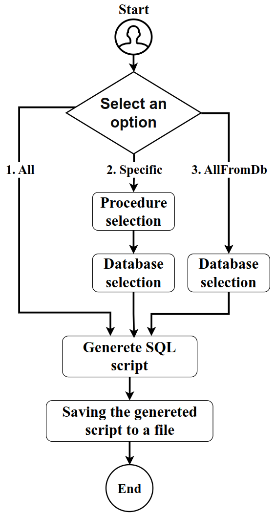
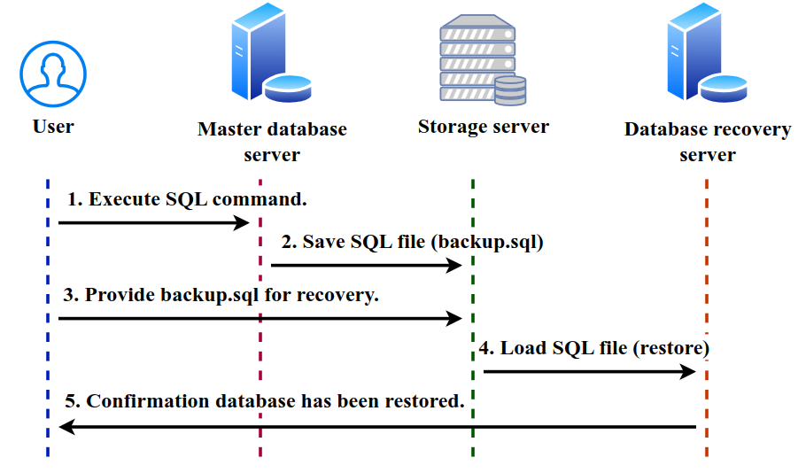

# flexmysqlbackup

**Selective MySQL backups and practical migration tools.**

[](LICENSE)
[](https://www.mysql.com/)
[](process_sql_opt.sh)
[](https://www.python.org/)

Export the database objects you need, keep their SQL definitions readable, and apply configurable transformations when migrating stored routines to MySQL 8.4.

**[Quick start](#quick-start)** · **[Routine exports](#routine-exports)** · **[Other database objects](#other-database-objects)** · **[Restore](#restore)** · **[Troubleshooting](#troubleshooting)**

---

## Overview

flexmysqlbackup combines metadata queries, SQL generator procedures, and Bash automation to export schemas, table definitions, data, views, routines, triggers, and events.

- **Choose the scope:** export one object, one database, or a broader selection.
- **Prepare routine SQL for migration:** update selected legacy syntax and character set definitions.
- **Keep control of the output:** inspect the generated SQL before restoring it.

Table data is exported through generated `mysqldump` commands. The other scripts focus on object definitions and selective exports.

<details>
<summary><strong>Contents</strong></summary>

- [Quick start](#quick-start)
- [Requirements](#requirements)
- [Repository guide](#repository-guide)
- [Routine exports](#routine-exports)
  - [Export modes and filenames](#export-modes-and-filenames)
  - [Filters](#filters)
  - [MySQL 8.4 transformations](#mysql-84-transformations)
  - [Transform an existing SQL file](#transform-an-existing-sql-file)
- [Other database objects](#other-database-objects)
  - [Configure a source connection](#configure-a-source-connection)
  - [Install the SQL generators](#install-the-sql-generators)
  - [Export examples](#export-examples)
- [Restore](#restore)
- [Compatibility notes](#compatibility-notes)
- [Troubleshooting](#troubleshooting)
- [Workflow diagrams](#workflow-diagrams)
- [Publication](#publication)
- [Contributing](#contributing)
- [License and author](#license-and-author)

</details>

## Quick start

### 1. Clone the repository

```bash
git clone https://github.com/tuthon/flexmysqlbackup.git
cd flexmysqlbackup
```

### 2. Configure the routine exporter

Edit the connection settings near the beginning of [`process_sql_opt.sh`](process_sql_opt.sh):

```bash
MYSQL_USER="your_db_user"
MYSQL_HOST="your_source_host"
MYSQL_PORT="3306"
```

The script prompts for the password without displaying it.

### 3. Run the exporter

```bash
bash process_sql_opt.sh
```

Choose all routines, one routine, or all routines in a database. The resulting SQL file is written to the current directory.

> [!NOTE]
> Routine exports append to their output file. Before starting a fresh export, move an earlier file out of the way or use a separate working directory. A failed export may leave a partial output file.

The routine exporter works directly with `SHOW CREATE`; installing the SQL generator procedures is only necessary for the other object types described below.

## Requirements

| Component | Used for |
|---|---|
| MySQL command-line client (`mysql`) | Connecting, exporting definitions, installing generators, and restoring SQL |
| Bash | Running the exporter and generated shell scripts |
| GNU `sed` | Formatting routine export output |
| Python 3 | SQL transformations in `process_sql_opt.sh`; standard library only |
| `mysqldump` | Table data exports |
| MySQL account with the appropriate privileges | Reading metadata and object definitions; creating generators or restoring objects where required |

The Bash exporter is intended for Linux or an environment providing Bash and GNU `sed`. Offline transformation requires Python 3 but does not connect to MySQL.

Required privileges depend on the source version and object type. Reading routine definitions, viewing table data, and restoring objects can require different permissions.

## Repository guide

| File | Purpose |
|---|---|
| [`process_sql_opt.sh`](process_sql_opt.sh) | Export procedures and functions; optionally transform an existing SQL file |
| [`gen_schemes_script.sql`](gen_schemes_script.sql) | Install the schema definition generator |
| [`gen_table_script.sql`](gen_table_script.sql) | Install the table structure generator |
| [`gen_data_script.sql`](gen_data_script.sql) | Install the generator for data-export shell commands |
| [`gen_view_script.sql`](gen_view_script.sql) | Install the view definition generator |
| [`gen_triggers_script.sql`](gen_triggers_script.sql) | Install the trigger definition generator |
| [`gen_event_script.sql`](gen_event_script.sql) | Install the event definition generator |
| [`figure3.png`](figure3.png), [`figure5.png`](figure5.png) | Workflow diagrams |

## Routine exports

### Export modes and filenames

The interactive menu in `process_sql_opt.sh` provides three modes:

| Choice | Export scope | Output filename |
|---|---|---|
| `1` | Procedures and functions across databases, subject to filters | `HOST_all_proc.sql` |
| `2` | One named procedure or function in a database, subject to filters | `HOST_DATABASE.ROUTINE.sql` |
| `3` | Procedures and functions in one database, subject to filters | `HOST_DATABASE.sql` |

`HOST`, `DATABASE`, and `ROUTINE` are replaced with the configured source host and selected names.

The generated SQL includes database selection, `DROP ... IF EXISTS`, routine definitions, and delimiter statements. Exporting reads the source definitions; it does not recreate routines on the source server.

### Filters

Edit these settings near the beginning of the script:

```bash
EXCLUDE_SP_PATTERNS=(
    '%copy' '%copy1' '%copy2' '%copy3'
    'alter_table' '%transfer_casino_balance_shard%'
)

EXCLUDED_SCHEMAS=()
MAX_DIGITS_IN_NAME=5
```

| Setting | Behavior |
|---|---|
| `EXCLUDE_SP_PATTERNS` | Exclude routine names using SQL `LIKE` patterns: `%` matches a sequence of characters and `_` matches one character |
| `EXCLUDED_SCHEMAS` | Exclude the listed schemas; the default list is empty |
| `MAX_DIGITS_IN_NAME` | Exclude names containing this many digits or more, counted across the entire name; set `0` to disable |

With the default threshold, these names are excluded:

```text
bet_radar_parser_live20191121
bet_radar_parser_live2019-11-21 11:40:58
procedure12345
```

`procedure1234` remains eligible unless another filter excludes it.

Filters apply to **procedures and functions in all three modes**, including an explicitly requested single routine. To exclude system schemas from routine exports, add their names to `EXCLUDED_SCHEMAS`.

### MySQL 8.4 transformations

The exporter processes active SQL tokens while protecting string literals, comments, and already quoted identifiers.

| Transformation | Result |
|---|---|
| Handler variables `errNom` and `errText` | Use `@errNom` and `@errText` in diagnostics, logging, and references to migrated variables |
| Corresponding local declarations | Remove the migrated variables while preserving other variables in the same declaration or line |
| Configured reserved identifiers, such as `over` and `groups` | Add backticks where handled as identifiers |
| `REGEXP BINARY` | Keep `REGEXP` and remove the following `BINARY` |
| Explicit `utf8` or `utf8mb3` definitions | Convert to `utf8mb4` |
| Supported legacy collations | Convert to the matching `utf8mb4` collation |
| Existing `utf8mb4` definitions | Keep active and unchanged |
| `GROUP BY expression DESC` | Remove only `DESC`; no `ORDER BY` is added |

Character set conversion covers local variables, routine parameters, function return types, and column/table settings in `CREATE TABLE` and `CREATE TEMPORARY TABLE`.

```sql
-- Before
DECLARE gameName VARCHAR(255) CHARSET utf8 DEFAULT '';
CREATE TABLE example (id BIGINT)
    DEFAULT CHARSET=utf8 COLLATE=utf8_general_ci;
SELECT id FROM example GROUP BY id DESC LIMIT 1;

-- After
DECLARE gameName VARCHAR(255) CHARSET utf8mb4 DEFAULT '';
CREATE TABLE example (id BIGINT)
    DEFAULT CHARSET=utf8mb4 COLLATE=utf8mb4_general_ci;
SELECT id FROM example GROUP BY id LIMIT 1;
```

These changes are controlled by:

```bash
CONVERT_UTF8_TO_UTF8MB4=1
REMOVE_GROUP_BY_DESC=1
```

Set either value to `0` to disable that transformation. The configurable `QUOTE_IDENTIFIERS` list controls identifier quoting.

### Transform an existing SQL file

Write the transformed SQL to a separate file:

```bash
bash process_sql_opt.sh --transform input.sql output.sql
```

Or update the input file in place:

```bash
bash process_sql_opt.sh --transform input.sql
```

This mode skips the password prompt and interactive menu. Input must be valid UTF-8. The transformed result is written atomically after processing succeeds.

## Other database objects

The SQL generator procedures provide exports for schemas, tables, data, views, triggers, and events.

### Configure a source connection

The following examples use a Bash array to keep connection options in one place. Replace the host and user values, then run it in your terminal:

```bash
MYSQL_SOURCE=(
    mysql
    --host=YOUR_SOURCE_HOST
    --port=3306
    --user=YOUR_USER
    --password
    --default-character-set=utf8mb4
    --init-command="SET NAMES utf8mb4 COLLATE utf8mb4_general_ci"
    --batch
    --raw
    --skip-column-names
)
```

Each invocation prompts for the password. `--raw` and `--skip-column-names` write the generated SQL without result headings or escaped display newlines.

### Install the SQL generators

The examples use a `tools` database for the generator procedures:

```bash
"${MYSQL_SOURCE[@]}" -e "CREATE DATABASE IF NOT EXISTS tools;"

for script in \
    gen_schemes_script.sql \
    gen_table_script.sql \
    gen_data_script.sql \
    gen_view_script.sql \
    gen_triggers_script.sql \
    gen_event_script.sql
do
    "${MYSQL_SOURCE[@]}" tools < "$script"
done
```

If you install the generators in another database, replace `tools.` in the calls below.

### Export examples

A single space (`' '`) is used below for an unspecified generator filter, following the existing procedure interfaces.

<details>
<summary><strong>Schemas</strong> — all or one database</summary>

```bash
# All schemas selected by the generator
"${MYSQL_SOURCE[@]}" \
    -e "CALL tools.gen_schemes_script(' ');" > schemas.sql

# One database
"${MYSQL_SOURCE[@]}" \
    -e "CALL tools.gen_schemes_script('your_database');" > database_schema.sql
```

</details>

<details>
<summary><strong>Table structures</strong> — scope, engine, and collation filters</summary>

```bash
# All tables selected by the generator
"${MYSQL_SOURCE[@]}" \
    -e "CALL tools.gen_table_script(1, ' ', ' ', ' ', ' ', ' ');" > tables.sql

# Tables in one database
"${MYSQL_SOURCE[@]}" \
    -e "CALL tools.gen_table_script(1, 'your_database', ' ', ' ', ' ', ' ');" > database_tables.sql

# One table
"${MYSQL_SOURCE[@]}" \
    -e "CALL tools.gen_table_script(1, 'your_database', 'your_table', ' ', ' ', ' ');" > table.sql

# Filter by storage engine
"${MYSQL_SOURCE[@]}" \
    -e "CALL tools.gen_table_script(1, ' ', ' ', 'InnoDB', ' ', ' ');" > innodb_tables.sql

# Replace a collation for a target that does not support the 0900 family
"${MYSQL_SOURCE[@]}" \
    -e "CALL tools.gen_table_script(1, ' ', ' ', ' ', 'utf8mb4_0900_ai_ci', 'utf8mb4_general_ci');" \
    > tables_compatible.sql
```

The six arguments control comment inclusion, database, table, engine, and the source/target replacement values illustrated above.

</details>

<details>
<summary><strong>Table data</strong> — generate and run mysqldump commands</summary>

Generate a shell script for the selected data:

```bash
printf '%s\n' '#!/usr/bin/env bash' 'set -e' > data_export.sh

# All data selected by the generator
"${MYSQL_SOURCE[@]}" \
    -e "CALL tools.gen_data_script(' ', ' ', ' ');" >> data_export.sh
```

For a narrower selection, replace the `CALL` above with one of these:

```sql
-- One database
CALL tools.gen_data_script('your_database', ' ', ' ');

-- One table
CALL tools.gen_data_script('your_database', 'your_table', ' ');
```

Review the generated `mysqldump` commands and configure their connection/authentication options before execution:

```bash
bash data_export.sh > data.sql
```

The generated commands have their own connection settings; they do not automatically inherit the `MYSQL_SOURCE` Bash array.

</details>

<details>
<summary><strong>Views</strong> — all, one database, or one view</summary>

```bash
"${MYSQL_SOURCE[@]}" \
    -e "CALL tools.gen_view_script(' ', ' ');" > views.sql

"${MYSQL_SOURCE[@]}" \
    -e "CALL tools.gen_view_script('your_database', ' ');" > database_views.sql

"${MYSQL_SOURCE[@]}" \
    -e "CALL tools.gen_view_script('your_database', 'your_view');" > view.sql
```

</details>

<details>
<summary><strong>Triggers</strong> — all, one database, or one trigger</summary>

```bash
"${MYSQL_SOURCE[@]}" \
    -e "CALL tools.gen_triggers_script(' ', ' ');" > triggers.sql

"${MYSQL_SOURCE[@]}" \
    -e "CALL tools.gen_triggers_script('your_database', ' ');" > database_triggers.sql

"${MYSQL_SOURCE[@]}" \
    -e "CALL tools.gen_triggers_script('your_database', 'your_trigger');" > trigger.sql
```

</details>

<details>
<summary><strong>Events</strong> — all, one database, or one event</summary>

```bash
"${MYSQL_SOURCE[@]}" \
    -e "CALL tools.gen_event_script(' ', ' ');" > events.sql

"${MYSQL_SOURCE[@]}" \
    -e "CALL tools.gen_event_script('your_database', ' ');" > database_events.sql

"${MYSQL_SOURCE[@]}" \
    -e "CALL tools.gen_event_script('your_database', 'your_event');" > event.sql
```

</details>

## Restore

Restore objects according to their dependencies. A typical sequence is:

| Step | Restore |
|---|---|
| 1 | Database/schema definitions |
| 2 | Table structures |
| 3 | Stored functions and procedures |
| 4 | Views, in dependency order |
| 5 | Table data |
| 6 | Triggers |
| 7 | Events |

Functions referenced by views must exist before those views are created. Loading data before installing triggers avoids firing restored triggers during the data import. Keep scheduled events inactive until their dependencies and data are ready.

Configure the target connection:

```bash
MYSQL_TARGET=(
    mysql
    --host=YOUR_TARGET_HOST
    --port=3306
    --user=YOUR_USER
    --password
    --default-character-set=utf8mb4
    --init-command="SET NAMES utf8mb4 COLLATE utf8mb4_general_ci"
    --comments
)
```

Then import the files you generated, replacing `HOST_all_proc.sql` with the actual routine export filename:

```bash
"${MYSQL_TARGET[@]}" < schemas.sql
"${MYSQL_TARGET[@]}" < tables.sql
"${MYSQL_TARGET[@]}" < HOST_all_proc.sql
"${MYSQL_TARGET[@]}" < views.sql
"${MYSQL_TARGET[@]}" < data.sql
"${MYSQL_TARGET[@]}" < triggers.sql
"${MYSQL_TARGET[@]}" < events.sql
```

If you change the target's Event Scheduler state during restoration, restore its previous state after completing the import.

## Compatibility notes

- **Routine migrations target MySQL 8.4.** The transformations address specific syntax and character set cases; they do not validate every possible stored program.
- **Older targets can require different choices.** For example, the table generator can replace `utf8mb4_0900_ai_ci` with `utf8mb4_general_ci`.
- **Routine definers are retained.** Review `DEFINER` accounts and the target account's privileges before importing the routine SQL.
- **No automatic rewrite of dynamic SQL strings.** SQL stored inside string literals is preserved.
- **Unknown collation mappings stop with an error.** Choose an explicit target mapping rather than assuming every legacy collation has a matching `utf8mb4` name.
- **Routine filtering is configurable.** The Bash exporter starts with an empty schema-exclusion list; filtering in the SQL generators is implemented separately.
- **Routine exports append to existing files.** Use a fresh output file for a fresh run.

## Troubleshooting

| Symptom | Check |
|---|---|
| `ERROR 1045: Access denied` | Confirm the configured host, port, user, and entered password. The routine exporter bypasses saved MySQL option files and login paths. |
| Invalid UTF-8 / byte `0x96` | Re-export using the current script's UTF-8 connection settings. SQL-file encoding and variable character set declarations are separate concerns. |
| Syntax error near `GROUP BY ... DESC` | Generate a fresh export or run offline transformation on the original SQL. Only the `DESC` modifier is removed. |
| A requested routine is missing | Check exclusion patterns, schema exclusions, the digit threshold, and access to its definition. Filters also apply in single-routine mode. |
| Unsupported collation mapping | Review the named collation and choose a supported `utf8mb4` equivalent. |
| Import fails on a `DEFINER` account | Review the original definer and permissions on the target server. |
| Re-running creates repeated definitions | Start with a fresh output file; the interactive exporter appends to the existing file. |

## Workflow diagrams

<details>
<summary><strong>Routine export workflow</strong></summary>



*Interactive procedure/function export workflow.*

</details>

<details>
<summary><strong>Backup and restore workflow</strong></summary>



*Overall backup and restore workflow.*

</details>

## Publication

Related research: [flexmysqlbackup — Computer Science and Interdisciplinary Research Journal (2025)](https://doi.org/10.70862/CSIR.2025.0201-10).

## Contributing

Bug reports, focused pull requests, and feature suggestions are welcome. For a proposed SQL transformation, include an input example, the expected output, and the relevant MySQL versions.

Discuss larger changes in a [GitHub issue](https://github.com/tuthon/flexmysqlbackup/issues) before implementation.

## License and author

Released under the [MIT License](LICENSE).

Created by **Dimitar Todorov** · [GitHub](https://github.com/tuthon) · [Email](mailto:tuthon@gmail.com)
